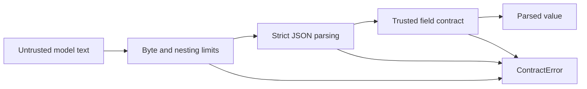

# JSON Response Gate

[](https://github.com/luminosstudioai-creator/json-response-gate/actions/workflows/ci.yml)

**A model saying “here is your JSON” is not an application contract.**
This small Python library accepts a complete JSON response only when every
field satisfies an explicit contract. No coercion, JSON extraction or silent repair.

Useful between an LLM extraction step and trusted application code: invoice
processing, form extraction, classification and bounded structured outputs.



## Try it in 30 seconds

```sh
git clone https://github.com/luminosstudioai-creator/json-response-gate.git
cd json-response-gate
python3 demo.py
```

The demo accepts a synthetic invoice, rejects a string where a number is
required, and rejects an unexpected `execute` field. It never runs that field.

```python
from gate import validate, ContractError

contract = {
    "type": "object",
    "fields": {
        "total": {"type": "number", "min": 0},
        "currency": {"type": "string", "choices": ["EUR", "USD"]},
    },
    "required": ["total", "currency"],
}

value = validate('{"total":42.5,"currency":"EUR"}', contract)
# {'total': 42.5, 'currency': 'EUR'}
try:
    validate('{"total":"42.5","currency":"EUR"}', contract)
except ContractError as error:
    print(error)  # $.total: wrong type
```

## Contract rules

| Type | Optional rules | Required configuration |
|---|---|---|
| string | max_length, choices | — |
| integer / number | min, max, choices | — |
| boolean | choices | — |
| null | — | — |
| object | required | fields |
| array | max_length | items |

Object fields are optional unless listed in `required`. Extra fields always
fail. Booleans never count as integers or numbers. `number` permits integers
and finite floats. Bounds are inclusive; string lengths count code points.

Duplicate keys, non-finite numbers, malformed Unicode, Markdown fences,
trailing prose and unknown contract rules fail. Defaults: 65,536 UTF-8 response
bytes, nesting limit 20, trusted contract depth at most 20.

## Trust boundary

Contracts are trusted application configuration. Error paths can contain
contract field names but never response values or unknown response key names.
This is a deliberately small custom contract format, **not JSON Schema**.
It checks structure, not factual correctness, permissions, prompt injection,
or whether an accepted action should be executed. Keep those decisions in the
application. Input is already in memory before the byte check; impose transport
limits too. Raising resource limits changes the caller's risk budget.

## Verification

```sh
python3 -m unittest discover -s tests -v
python3 -m pip install --no-deps .
```

CI runs tests, installs the package and imports it outside the checkout on
Python 3.11, 3.12 and 3.13. No runtime dependencies, API credentials or paid model
calls are required. Build tooling is separate from the runtime.

## Provenance

A new, standalone implementation by Mika Mischke. Examples are synthetic.
This repository does not contain private application code, client datasets,
customer references or a claim of production deployment. MIT licensed.
